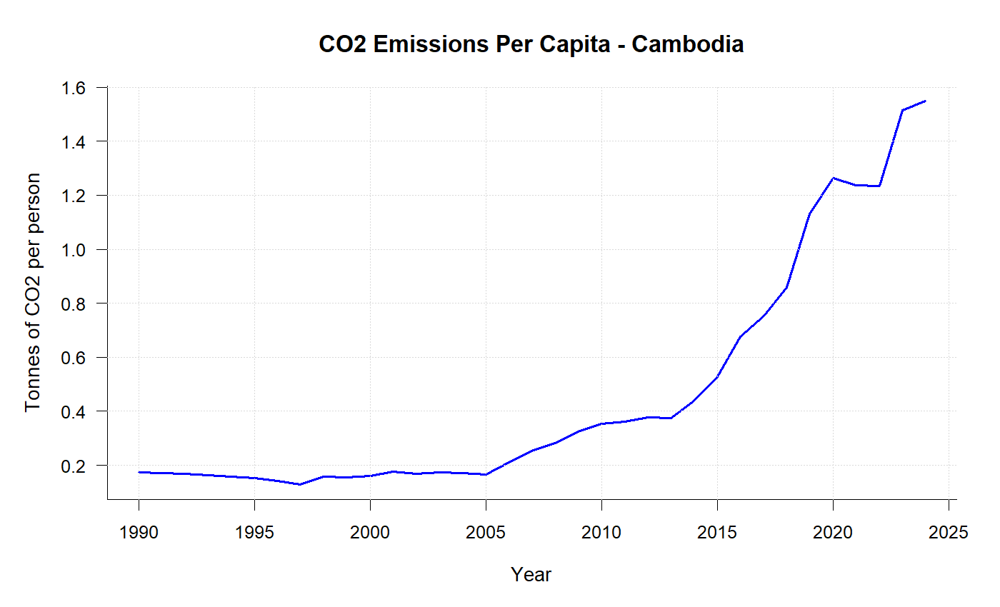
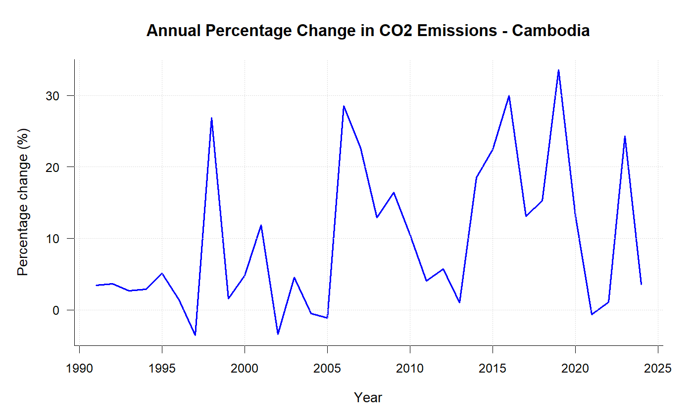

Author: Elaika A. Velonta

# CO2 Emissions Analysis in Cambodia (KHM)

## Objectives

- To examine the annual CO2 emissions in Cambodia.
- To analyze the annual CO2 emissions per capita.
- To determine the annual percentage change in CO2 emissions.
- To visualize the trends using graphs generated in RStudio.

- 1. Research Question

How have Cambodia's annual CO₂ emissions, CO₂ emissions per capita, and annual percentage changes in CO₂ emissions changed from 1990 to 2024?

This project aims to examine the trends and changes in Cambodia's CO₂ emissions over the selected study period through data analysis and visualization.

2. Country and Study Period

Country: Cambodia
Country Code: KHM
Study Period: 1990–2024
Main Variables:
Annual CO₂ emissions
CO₂ emissions per capita
Annual percentage change in CO₂ emissions

3. Data Source

The analysis uses a CO₂ emissions dataset for Cambodia covering the period 1990–2024.
The dataset is stored in the data folder as KHM_co2.csv.
Original Data Source: [Insert the original dataset source and link here.]

4. Software and Tools
The following software and tools were used in this project:

R – for data processing, statistical calculations, and analysis.
RStudio – as the integrated development environment for running R scripts.
Git – for version control and tracking project changes.
GitHub – for repository hosting and project documentation.
R packages – packages used for data manipulation and visualization.

5. Instructions to Reproduce the Analysis
To reproduce the analysis:
Download or clone this repository.
Open the co2-emission-KHM.Rproj file in RStudio.
Make sure the required R packages are installed.
Locate the original dataset in the data folder.
Run the R scripts in the scripts folder.
The processed datasets and summary results are available in the results folder.
The generated visualizations are saved in the figures folder.

6. Important Results

The analysis examines the changes in Cambodia's CO₂ emissions from 1990 to 2024.
The main results focus on:
The long-term trend in annual CO₂ emissions.
Changes in CO₂ emissions per capita.
Year-to-year increases and decreases in CO₂ emissions.

The dataset contains information about CO2 emissions and related variables. The data was processed and filtered to focus on Cambodia (KHM) for the analysis.

7. Figures

### 1. Annual CO2 Emissions

### 2. CO2 Emissions Per Capita

### 3. Annual Percentage Change in CO2 Emissions

8. Interpretation and Discussion

The visualizations illustrate the trends in Cambodia's CO₂ emissions over the 1990–2024 period. Annual CO₂ emissions show the changes in the country's total emissions, while emissions per capita provide a population-adjusted perspective.
The annual percentage change further shows the year-to-year fluctuations in emissions, identifying periods of increase and decrease.

Together, these visualizations provide an overview of the development of Cambodia's CO₂ emissions during the selected study period.

9. Limitations

This analysis is limited to the available data for Cambodia from 1990 to 2024. The findings are based on the variables included in the dataset and do not independently establish the causes of changes in CO₂ emissions.
The analysis also depends on the accuracy, completeness, and consistency of the original dataset.

10. References

