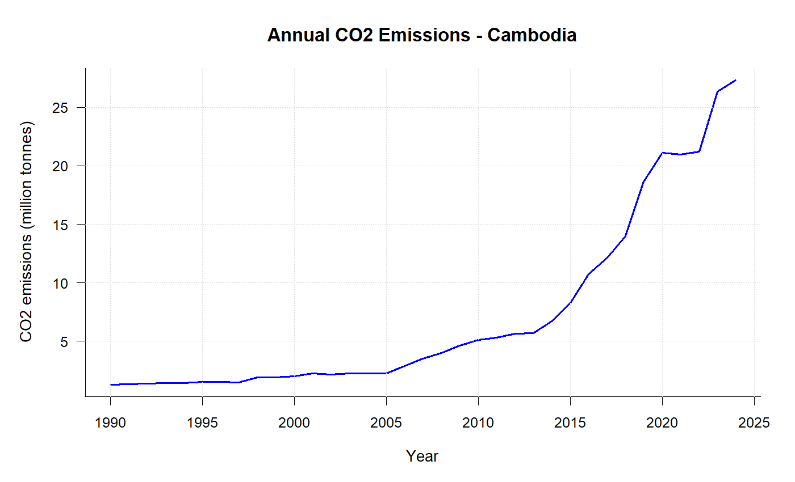

# CO2 Emissions Analysis in Cambodia (KHM)

## Project Overview

This project focuses on analyzing carbon dioxide (CO2) emissions in Cambodia using RStudio. It explores annual CO2 emissions, CO2 emissions per capita, and annual percentage changes to understand the trends in the country's carbon emissions over time.

## Objectives

- To examine the annual CO2 emissions in Cambodia.
- To analyze the annual CO2 emissions per capita.
- To determine the annual percentage change in CO2 emissions.
- To visualize the trends using graphs generated in RStudio.

## Repository Structure

```text
co2-emission-KHM/
|-- data/
|-- figures/
|-- results/
|-- scripts/
|-- .gitignore
|-- README.md
|-- co2-emission-KHM.Rproj
```

## Dataset

The dataset contains information about CO2 emissions and related variables. The data was processed and filtered to focus on Cambodia (KHM) for the analysis.

## Analysis and Visualizations

### 1. Annual CO2 Emissions



### 2. CO2 Emissions Per Capita


### 3. Annual Percentage Change in CO2 Emissions


## Tools Used

- RStudio
- R Programming Language
- Git and GitHub
- Data visualization packages in R

## How to Run the Project

1. Download or clone this repository.
2. Open the co2-emission-KHM.Rproj file in RStudio.
3. Open scripts/analyze_co2.R.
4. Run the script to perform the data processing and analysis.
5. View the generated graphs in the figures folder and outputs in the results folder.

## Author

CO2 Emissions Analysis Project - Cambodia (KHM)


